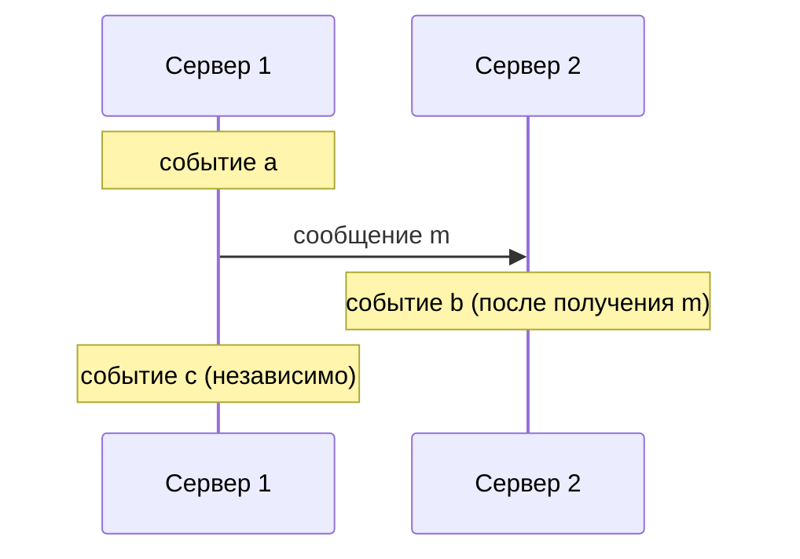
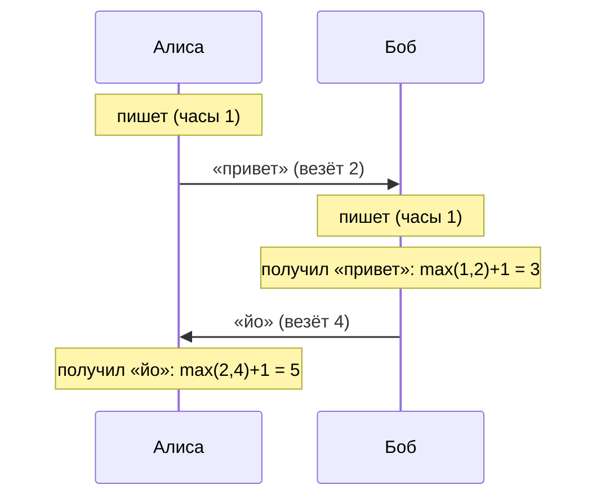
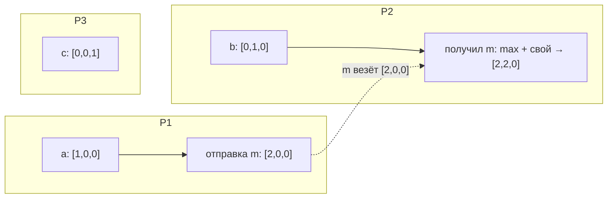
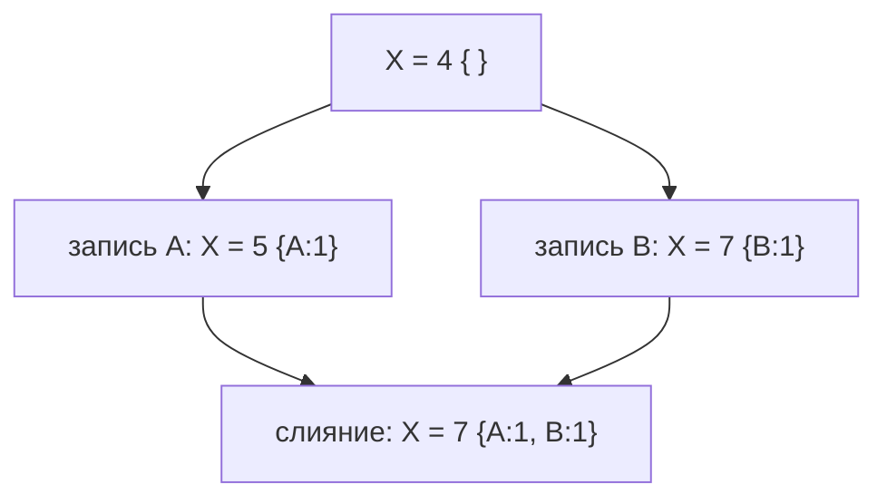
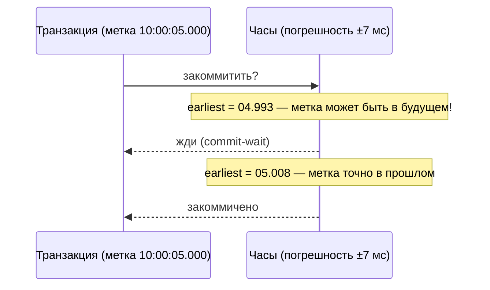
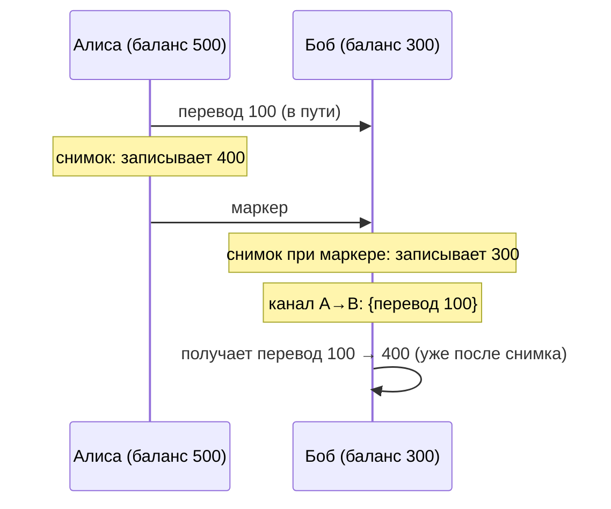

# 01 — Время, порядок и причинность

Зачем это нужно: в распределённой системе нет общих часов. Два сервера могут думать, что «сейчас» — разное время, а сообщения идут непредсказуемо долго. Без специальных приёмов нельзя ответить даже на простой вопрос: «какое событие было раньше?» А без ответа на него нельзя упорядочить записи, разрешить конфликты версий и понять, кто тут лидер.

Идея раздела в одном предложении: **мы заменяем отсутствующие общие часы причинно-следственными связями, а где нужны именно часы — учитываем их погрешность явно.**

---

## 1. Happens-before: «могло ли одно событие повлиять на другое»

Лэмпорт (1978) предложил не спрашивать «когда это случилось по часам», а спрашивать: **«могло ли событие A повлиять на событие B?»** Отношение обозначается `A → B` и строится из трёх правил:

1. Внутри одного процесса: события идут по порядку программы. Что раньше в коде — то и `→`.
2. Отправка и получение: `отправка сообщения → получение этого сообщения`.
3. Транзитивность: если `A → B` и `B → C`, то `A → C`.

Если ни `A → B`, ни `B → A` — события **параллельны (concurrent)**. Это не значит «в один момент времени». Это значит: «они ничего друг о друге не знали, поэтому их порядок не определён».

Здесь `a → b` (через сообщение `m`), а `c` параллельно  `b`: сервер 1 сделал `c` сам по себе, никого не уведомив.

Вывод, который пригодится дальше: **happens-before — это частичный порядок**. Не для каждой пары событий можно сказать, что было раньше. Все остальные часы ниже — это попытки выразить этот порядок числами.

---

## 2. Часы Лэмпорта: один счётчик на процесс

Правила простые:

- перед каждым локальным событием и отправкой: `часы += 1`;
- каждое сообщение везёт с собой значение часов отправителя;
- при получении: `часы = max(свои, чужие) + 1`.

Гарантия: **если `A → B`, то `часы(A) < часы(B)`**. Порядок чисел уважает причинность.

Пример. Алиса и Боб переписываются:

Таблица значений:

| Шаг | Событие | Часы |
|---|---|---|
| A1 | Алиса пишет | 1 |
| A2 | Алиса отправляет «привет» | 2 |
| B1 | Боб пишет | 1 |
| B2 | Боб получает «привет» | 3 |
| B3 | Боб отправляет «йо» | 4 |
| A3 | Алиса получает «йо» | 5 |

Ограничение — и оно ключевое: **обратное неверно**. `часы(A) < часы(B)` НЕ значит, что `A → B`. В таблице `A1 (1) < B1 (1)`? Нет, равны. А вот `B1 (1) < A2 (2)` — но Боб писал независимо от отправки Алисы, причинной связи нет. Скалярные часы дают полный порядок чисел, но **склеивают параллельные события**, различить их нельзя.

Практический смысл: часов Лэмпорта хватает там, где нужен просто одинаковый порядок у всех (например, упорядочить запросы в очереди), но их **не хватает, чтобы понять, конфликтуют ли две версии данных**. Для этого нужны векторные часы.

---

## 3. Векторные часы: видим параллельность

У каждого процесса — вектор из N счётчиков (по одному на процесс): `[v1, v2, v3]`.

- локальное событие / отправка: увеличиваю **свой** счётчик;
- сообщение везёт весь вектор;
- при получении: поэлементный `max`, потом `+1` к **своему** счётчику.

Сравнение векторов:

- `V ≤ W`, если каждый элемент `V` не больше соответствующего в `W`;
- `V < W` (то есть `V → W`), если `V ≤ W` и хоть один элемент строго меньше;
- иначе события **параллельны**.

Пример для трёх процессов:

Разбор:

- `a = [1,0,0]`, `b = [0,1,0]` — ни один не ≤ другого → **параллельны**. Верно: процессы ничего друг о друге не знали.
- Получение `m` процессом 2: `max([0,1,0], [2,0,0]) = [2,1,0]`, плюс свой счётчик → `[2,2,0]`. Теперь `[2,0,0] < [2,2,0]` → отправка `→` получение. Причинность видна.
- `c = [0,0,1]` параллельно всем остальным.

### Где это живёт: version vectors в key-value хранилищах

Dynamo / Riak / Cassandra хранят у каждого значения **вектор версий** (то же самое, только счётчики — по клиентам/узлам, а не по всем процессам мира). Сценарий:

1. Клиент А пишет `X = 5` → версия `{A:1}`.
2. Параллельно клиент Б пишет `X = 7` → версия `{B:1}`.
3. `{A:1}` и `{B:1}` несравнимы → **конфликт**. Система не выдумывает победителя, а отдаёт обе версии-«сиблинги» читателю.
4. Читатель сливает (`X = 7`, раз Б новее по смыслу) и пишет обратно → `{A:1, B:1}` — потомок обоих, конфликт закрыт.

Улучшение для экономии места — **dotted version vectors**: вместо полного вектора на клиента хранится одна «точка» (узел + счётчик). Точности для разрешения конфликтов хватает, а размер не растёт с числом клиентов.

---

## 4. Физические часы: они врут, учитываем насколько

Проблема в одном слове — **skew** (расхождение). Двое часов идут с разной скоростью (drift), плюс их кто-то когда-то выставил по-разному. Ошибка в миллисекунды — норма, а лиза или таймаут короче skew ломают корректность: узел А считает аренду своей, узел Б — уже своей. Два лидера, запись потеряна.

Классика синхронизации:

- **Алгоритм Кристиана**: спрашиваю сервер времени, вычитаю половину RTT. Точность — порядка RTT.
- **Алгоритм Беркли**: мастер опрашивает всех, считает среднее (выкидывая выбросы) и рассылает поправки. Все «вместе неправы, но одинаково».
- **NTP**: иерархия stratum-серверов, точность — миллисекунды в интернете. **PTP** — микросекунды, но в локальной сети со специальным железом.

### TrueTime (Spanner): не скрывать погрешность, а выдать её наружу

Google поставил атомные часы + GPS в дата-центры и сделал API, который возвращает не «время», а **интервал** `[earliest, latest]`, внутри которого точно лежит настоящее время. А дальше — гениально простой приём **commit-wait**: транзакция с меткой `t` считается закоммиченной только когда `t` гарантированно в прошлом, то есть ждём, пока `earliest > t`.

Цена — задержка коммита на величину неопределённости (миллисекунды). Выигрыш — **внешняя согласованность**: если клиент увидел коммит и потом начал новую транзакцию, она получит большую метку. Реальное время снова уважается.

### HLC (CockroachDB): гибрид без атомных часов

Гибридные логические часы хранят пару `(l, c)`: `l` — физическая компонента, `c` — счётчик. Правила: `l = max(своя l, l из сообщения, физическое время)`, при совпадении `l` растёт `c`. Получаем часы, которые:

- близки к физическому времени (удобно для TTL, лиз, отладки);
- **монотонны** и уважают причинность, как часы Лэмпорта;
- работают на обычных NTP-часах.

Проще говоря: HLC = «часы Лэмпорта, которые стараются не отставать от настенных».

Частный случай компромисса — **bounded staleness**: чтению разрешено отставать не больше чем на X секунд/версий. Дешевле линеаризуемости, честнее «как получится».

---

## 5. Снимки Chandy-Lamport: фото системы на бегу

Задача: получить **консистентный глобальный снимок** (состояния всех процессов + сообщения в пути), не останавливая систему. Нужно для checkpoint'ов, детекта deadlock'а, догоняющей репликации.

Идея — **маркеры**:

1. Процесс-«фотограф» записывает своё состояние и шлёт маркер по всем исходящим каналам.
2. Кто получил маркер впервые — записывает своё состояние, объявляет канал, по которому пришёл маркер, пустым, и рассылает маркер дальше.
3. Все сообщения, пришедшие по каналу **до** маркера, считаются частью состояния канала (были «в пути» на момент снимка). После маркера — уже новая эпоха, не пишем.

Пример: Алиса перевела Бобу 100, деньги в пути, тут начался снимок.

Итог снимка: Алиса 400 + Боб 300 + в канале 100 = 800. Сошлось с реальностью (500 + 300), хотя «одновременного момента» не было. Вот что значит консистентный срез: **если снимок включает получение сообщения, он включает и его отправку** (замкнутость по причинности — привет, happens-before из пункта 1).

Та же механика — checkpoint'и во Flink: барьеры в потоке данных и есть маркеры (подробнее в разделе `10`).

---

## Шпаргалка

| Инструмент | Что гарантирует | Чего не умеет | Где встречается |
|---|---|---|---|
| Happens-before | частичный порядок причинности | выразить числами | везде как ментальная модель |
| Часы Лэмпорта | `A → B ⟹ часы(A) < часы(B)` | отличить параллельные события | очереди запросов, RSM-таймстемпы |
| Векторные часы | `A → B ⟺ V(A) < V(B)`, видят параллельность | компактность (размер O(N)) | version vectors в Dynamo/Riak/Cassandra |
| Dotted VV | то же, компактно | — | Riak |
| NTP/PTP | стены примерно совпадают | гарантий для корректности | всё подряд |
| TrueTime | интервал с гарантией + commit-wait | дёшево (нужно железо) | Spanner |
| HLC | причинность + близость к стенным часам | гарантию реального времени | CockroachDB |
| Chandy-Lamport | консистентный срез без остановки | мгновенность | checkpoint'и, state transfer |

Типичные ошибки новичка:

1. «Возьму timestamp wall-clock для порядка записей» — при skew порядок инвертируется, записи теряются. Для порядка — Лэмпорт/HLC, для реального времени — TrueTime с commit-wait.
2. «Векторные часы скажут, что было раньше по времени» — нет, они говорят о причинности. Два параллельных события могут разделять годы.
3. «Чтение у лидера всегда свежее» — после раздела старый лидер отдаёт старьё. Лечится лизой/ReadIndex (раздел `03`).

Дальше: `02` — что бывает, когда серверы падают и сеть врёт; `03` — как при всём этом договориться об общем логе.
