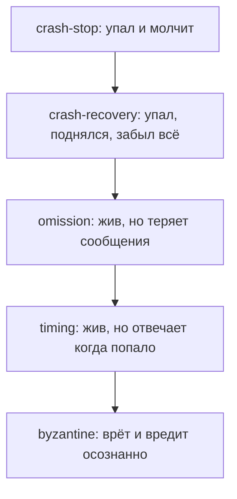
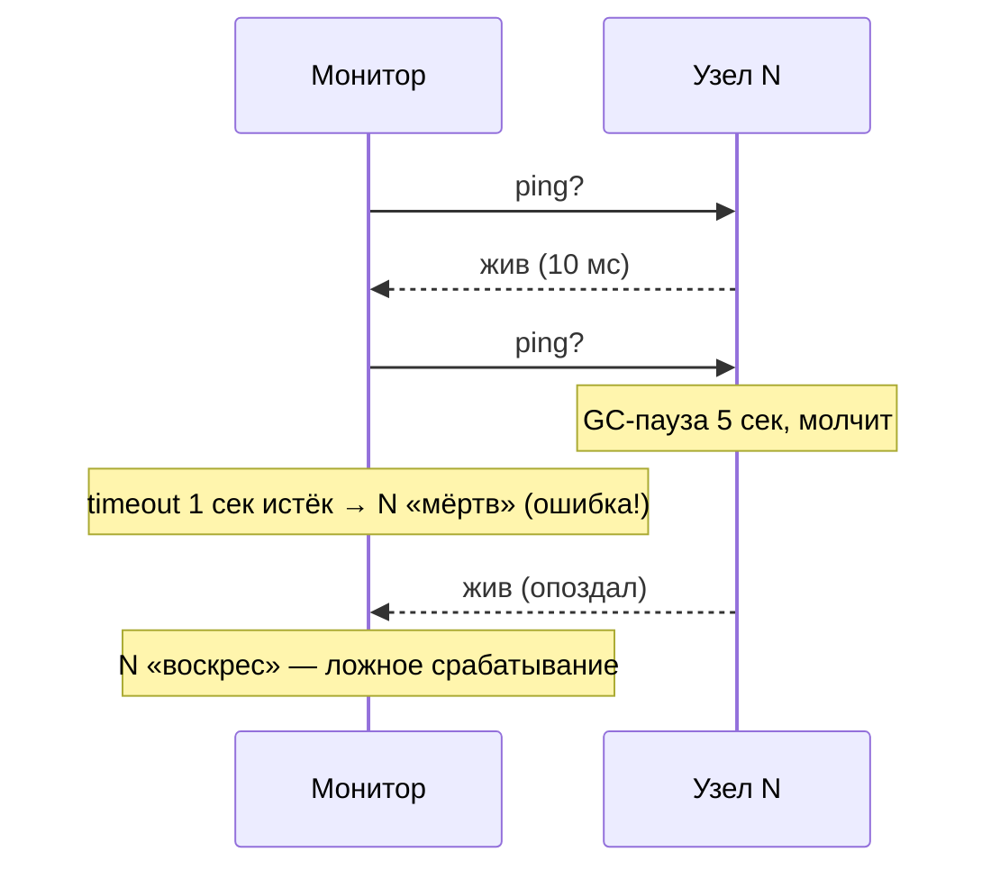
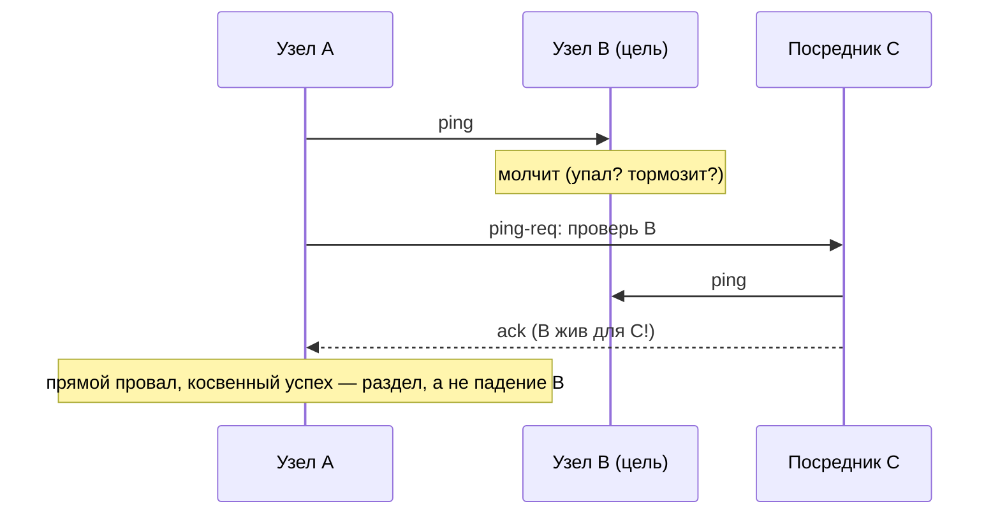
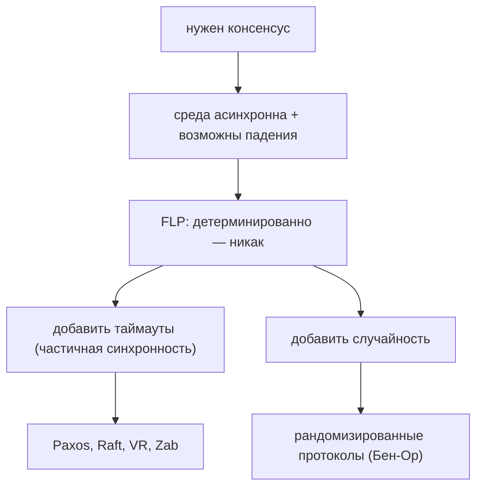
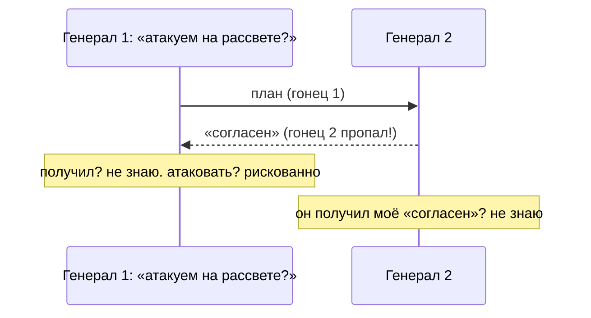
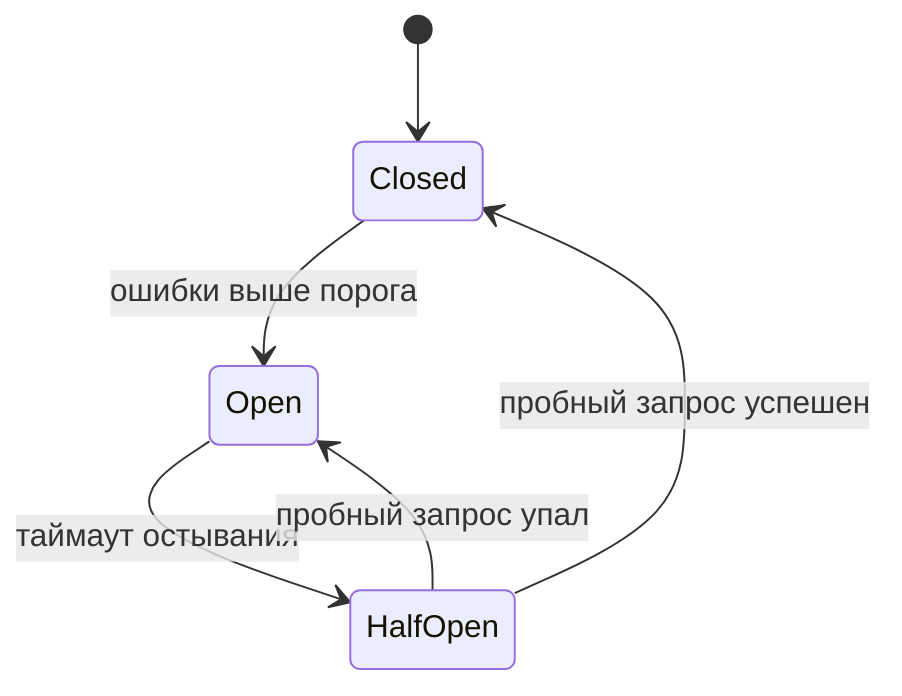

# 02 — Модели отказов и их обнаружение

Зачем это нужно: прежде чем проектировать протокол, надо зафиксировать, **что именно может сломаться**. От ответа зависит всё: протокол, корректный при падениях, разваливается при византийских узлах, а византийский протокол — в разы дороже. Ошибка новичка — проектировать «от всего сразу» или молча надеяться, что «сеть надёжная». Этот раздел учит называть отказ своим именем и честно говорить, что именно мы умеем отличать «упал» от «тормозит».

Идея раздела в одном предложении: **асинхронно отличить мёртвый процесс от медленного невозможно, поэтому все детекторы отказов — вероятностные, а все живые протоколы — с таймаутами.**

---

## 1. Модели отказов: лестница от «честных» падений до вранья

Упорядочим от слабых к сильным. Каждый следующий уровень включает предыдущие: протокол для верхних ступеней выдерживает и нижние, но платит за это сложностью.

Разберём с примерами:

- **Crash-stop.** Процесс убит (OOM-killer, `kill -9`, сгорел сервер) и больше не отвечает. Самый удобный отказ: молчание однозначно. Пример: follower в Raft-кластере погас — лидер просто перестаёт получать от него ответы.
- **Crash-recovery.** То же, но процесс перезапускается с чистого листа: память забыта, на диске — что успели сбросить. Отсюда железное правило: **всё, что влияет на корректность, — сначала на диск (WAL), потом ответ клиенту**. Перезапустившийся Raft-узел должен помнить свой `votedFor`, иначе проголосует дважды.
- **Omission.** Процесс жив, но сообщения теряются: переполнен сетевой буфер, дропнул switch, `send`-буфер сброшен при рестарте. Бывает send-omission (не отправил) и receive-omission (не получил). Пример: UDP-пакет потерян; TCP-переподключение выкинуло недоставленное.
- **Timing (performance).** Ответ приходит, но когда попало: GC-пауза на 10 секунд, сосед по виртуалке съел CPU, диск деградировал. Для синхронного протокола «опоздал» = «упал», и это главный источник ложных срабатываний детекторов.
- **Byzantine.** Узел ведёт себя произвольно: шлёт разным разные значения, подделывает, молчит выборочно. Причины — баги сериализации, bit flip в памяти, взлом. Лечится только BFT-протоколами (раздел `12`), цена — `3f+1` узел и сложные фазы.

Отдельно — **разделы сети (partitions)**: живы все, но друг друга не видят. Это не отказ одного узла, а отказ связей. Асимметричный раздел (А видит Б, но Б не видит А) ломает наивные детекторы: обе стороны считают друг друга мёртвыми.

---

## 2. Детекторы отказов: «ты мёртв?» — «наверное»

Детектор отказов — сервис, который говорит «узел X, кажется, упал». Ключевое слово — «кажется»: в асинхронной системе **доказать** падение нельзя (медленный неотличим от мёртвого), поэтому детектор может ошибаться, а протокол обязан это переживать (лидер свергнут понапрасну — ну и что, выберут нового, безопасность не пострадает).

Качество детектора описывают двумя свойствами (Чандра–Туэг):

- **Completeness (полнота)**: каждый реально упавший рано или поздно заподозрен. Сильная — все детекторы подозревают; слабая — хоть один.
- **Accuracy (точность)**: живые не подозреваются. Сильная — никогда; слабая — иногда можно; eventual — «в конце концов перестанем» (когда сеть успокоится).

Комбинации дают классы: Perfect (сильная полнота + сильная точность — в асинхронной системе **нереализуем**), Eventually Perfect `◇P`, Strong, Weak, Eventually Weak `◇W`. Важный результат: для консенсуса достаточно самого слабого — `◇W`. Мораль: **не нужен точный детектор, достаточно кворума и таймаутов**.

### Как устроены на практике

**Heartbeat + таймаут.** Шлю «я жив» каждые T мс, нет вестей дольше timeout — подозреваю. Просто, но таймаут — магическая константа: короткий — ложные срабатывания при GC-паузах, длинный — медленно замечаем реальные падения.

**Phi-accrual (Cassandra, Akka).** Вместо бинарного «жив/мёртв» копим подозрение: смотрим на историю интервалов heartbeat'ов и считаем `φ` — насколько текущее молчание невероятно. Растёт молчание — растёт `φ`; порог (обычно 8–12) настраивается под задачу. Плюс: адаптируется под конкретную сеть и нагрузку, а не константа из головы. Минус: при смене режима сети (день/ночь) история врёт.

**SWIM (gossip-детектор).** Каждый узел случайно выбирает цель, шлёт `ping` напрямую, а если ответа нет — просит `k` случайных посредников пингануть цель косвенно (`ping-req`). Только если и так тихо — рассылает gossip «X, кажется, мёртв». Плюс состояние «подозреваю» (suspect) вместо сразу «мёртв»: подозреваемый может опровергнуть слух. Нагрузка распределена, нет единой точки наблюдения.

---

## 3. FLP: почему «просто договориться» невозможно

Результат Фишера–Линч–Патерсон (1985): **в полностью асинхронной системе с хотя бы одним возможным crash-отказом нет детерминированного алгоритма консенсуса, который всегда завершается**. Не «мы не придумали», а «доказано, что нельзя».

Интуиция доказательства в двух шагах:

1. Есть **бивалентные** конфигурации — из них возможны и решение «0», и решение «1» (старт с разными голосами — как раз такая).
2. Всегда можно задержать «то самое» сообщение так, чтобы система осталась в бивалентной конфигурации: медленный процесс неотличим от упавшего, поэтому алгоритм обязан ждать его — а ждать можно вечно.

Проще говоря: **алгоритм не может отличить «упал» от «задержалось сообщение», а решение без этого принять нельзя — вот он и висит**.

Что из этого следует на практике — развилка:

Почти весь реальный мир пошёл по левой ветке — **модель частичной синхронности** (Дворк–Линч–Стокмайер): безопасность гарантируется всегда, а живость — когда наступает «спокойный период» (GST, global stabilization time), то есть сообщения начинают приходить за bounded-время. Raft-лидер в разделе не может закоммитить — это FLP в действии, система ждёт восстановления связи, и это нормально.

---

## 4. Задача двух генералов: последнее сообщение всегда под вопросом

Два генерала должны атаковать одновременно, связь — только ненадёжные гонцы (могут пропасть). Сколько подтверждений ни шли, **последнее всегда может потеряться — и отправитель не узнает, дошло ли оно**. Значит, гарантированно договориться нельзя в принципе.

Выводы для инженерии (используются каждый день):

- **Подтверждения (acks)** — обязательны, но решают проблему только вероятностно: ретраи делают потерю маловероятной, а не невозможной.
- **Ретраи + идемпотентность**: раз сообщение может прийти дважды (оригинал + повтор), получатель обязан переживать дубли. Это мост в раздел `08`: at-least-once доставка + идемпотентный consumer.
- **Никакой протокол поверх ненадёжного канала не даёт гарантий «ровно один раз» без дополнительной магии** (транзакции, дедуп, fencing).

---

## 5. Дисциплина таймаутов: как жить с тем, что «медленно» ≠ «мертво»

Раз отличить падение от задержки нельзя, работаем вероятностно и ограничиваем ущерб от ошибок:

- **Exponential backoff + jitter.** Повтор через 100 мс, 200, 400… плюс случайный разброс, чтобы тысячи клиентов не долбили одновременно (thundering herd). Jitter обязателен: синхронные ретраи — это DDoS на самого себя.
- **Circuit breaker.** Три состояния: closed (всё идёт), open (ошибок больше порога — быстрые отказы вместо ожидания), half-open (пробуем один запрос — получилось, закрываем).

- **Hedged requests** (мост в `11`): не ждать медленный ответ, а через p99 послать дубликат и взять первый пришедший. Лечит хвосты, но удваивает нагрузку на хвосте — включать осознанно.
- **Bulkhead**: изолировать пулы (соединения, потоки) по зависимостям, чтобы одна повисшая зависимость не съела всё.

Правило большого пальца: **таймаут — это не константа, а бюджет**. Складывай бюджеты по цепочке вызовов (deadline propagation), иначе три сервиса с таймаутом 5 с дадут пользователю 15 с ожидания.

---

## Шпаргалка

| Понятие | Суть одной фразой | Ловушка |
|---|---|---|
| Crash-stop / recovery | упал (и забыл всё) | recovery без WAL голосует/пишет дважды |
| Omission | жив, но теряет сообщения | TCP скрывает, но не убирает (реконнект = потери) |
| Timing | отвечает когда попало | GC-пауза выглядит как падение |
| Byzantine | врёт произвольно | лечится только BFT за `3f+1` |
| Partition | живы все, не видят друг друга | асимметричный раздел — самый коварный |
| Completeness / Accuracy | всех мёртвых ловим / живых не трогаем | Perfect-детектор в асинхронности невозможен |
| Phi-accrual | подозрение числом, а не флагом | история врёт при смене режима сети |
| SWIM | ping + ping-req + suspect-gossip | suspect ≠ dead, нужно опровержение |
| FLP | детерминированный консенсус в асинхронности невозможен | выход — таймауты (частичная синхронность) |
| Два генерала | последнее сообщение всегда под вопросом | лечится ретраями + идемпотентностью, не «ещё одним ack'ом» |
| Backoff + jitter | ждать дольше и не толпой | синхронные ретраи — сам себе DDoS |
| Circuit breaker | не ждать заведомо мёртвое | half-open без лимита — та же толпа |

Типичные ошибки новичка:

1. «Поставлю таймаут 100 мс — быстрее замечу падения». Получишь flap'ающий кластер: выборы каждые GC-паузы,/avalanche ретраев. Таймаут настраивают по p99+ сети, а не по желанию.
2. «Детектор сказал dead — значит, мёртв, выкидываю из кластера». Исключение — это смена membership (раздел `03`), а подозрение — лишь триггер. Путать их = split-brain.
3. «Сделаю синхронную систему с bounded-задержками — и FLP не про меня». Bounded работает, пока кто-то не положит switch, не начнётся GC-шторм и не кончится бюджет. Частичная синхронность — честная модель, синхронность — надежда.

Дальше: `03` — как при таких отказах договариваться об общем логе (Paxos/Raft); `08` — как ретраи не превращать в двойные списания; `09` — как аренда переживает ложные подозрения.
