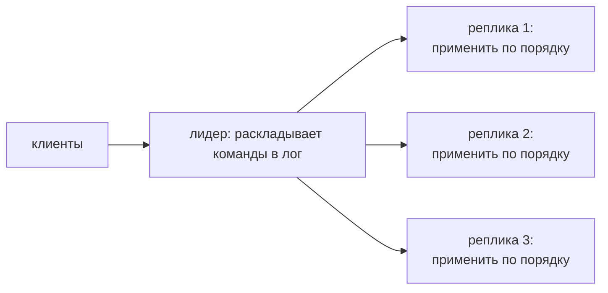
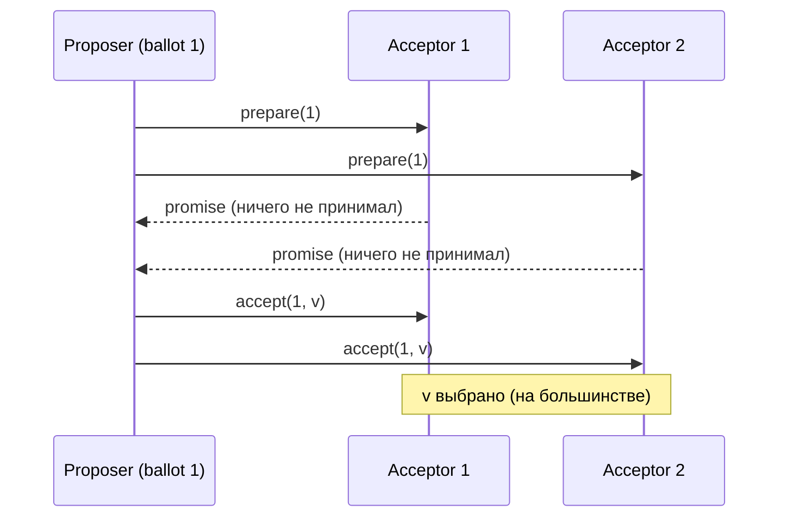
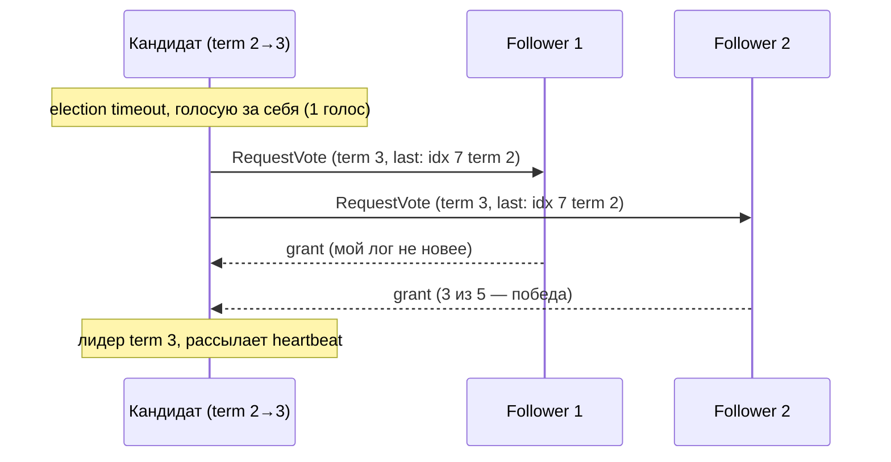

# 03 — Консенсус и репликация лога

Зачем это нужно: допустим, у нас три копии базы. Клиент пишет `X = 5` на одну копию — как сделать, чтобы остальные узнали и все копии остались одинаковыми, даже если серверы падают посреди операции? Ответ: все реплики выполняют **одни и те же команды в одном и том же порядке**. А чтобы договориться о порядке при падениях — нужен **консенсус**.

Идея раздела в одном предложении: **консенсус = способ договориться об общем логе команд, а одинаковый лог + детерминированное выполнение = одинаковое состояние всех реплик.**

Связь с прошлыми разделами: FLP из `02` говорит, что в чистой асинхронности договориться нельзя, — поэтому все протоколы ниже используют таймауты (частичная синхронность). А часы и порядок из `01` всплывут в ballot'ах и term'ах.

---

## 1. State machine replication: рамка, в которую всё ложится

Рецепт Шнайдера (1990):

1. Все реплики стартуют из одного начального состояния.
2. Все выполняют детерминированные команды (одна команда + одно состояние = один результат, без рандома и wall-clock внутри).
3. Все выполняют команды **в одинаковом порядке**.

Тогда состояния совпадают всегда — доказывать нечего, это следует из детерминизма. Вся сложность уезжает в пункт 3: обеспечить одинаковый порядок у всех. Для этого нужен **atomic broadcast** (все получают все сообщения в одном порядке), а он эквивалентен консенсусу: решили «какая команда идёт следующей» достаточное число раз — получили общий лог.

Детерминизм — с подвохом: `now()`, `rand()`, итерация по map в Go — всё это надо либо запретить в командах, либо протащить через лог (лидер генерирует timestamp/random и пишет его в команду как данные).

---

## 2. Кворумы: почему «большинство» работает

Безопасность почти всех протоколов держится на одном факте: **любые два большинства пересекаются**. Для N = 5 большинство — 3, пересечение двух троек — минимум 1 узел (`3 + 3 − 5 = 1`). Значит: если значение «выбрано» (записано на большинство) — любой следующий раунд опросит большинство и **обязательно встретит узел, который это значение помнит**. Проигнорировать выбранное значение невозможно физически — свидетель всегда найдётся.

Формула для тюнинга (пригодится в `04`–`05`): `W + R > N` — запись и чтение пересекаются. `W = N, R = 1` — пишем везде, читаем с одного; `W = 1, R = N` — наоборот. Большинство (`W = R = N/2 + 1`) — золотая середина.

---

## 3. Paxos: два раунда и обещание не передумывать

Роли: proposer (предлагает), acceptor (голосует и помнит), learner (узнаёт итог). У каждого предложения — растущий номер **ballot**. Раунд на одно значение:

- **Prepare**: proposer шлёт `prepare(n)` большинству. Acceptor отвечает `promise`: «обещаю больше не принимать ничего с номером меньше `n`» + прикладывает самое свежее принятое значение (если было).
- **Accept**: proposer смотрит на ответы: если кто-то уже принимал значение — обязан предложить **его** (с наибольшим номером), иначе — своё. Шлёт `accept(n, v)`. Acceptor принимает, если не обещал большего.

Пример: три acceptor'а, никто ничего не принимал.

А теперь приходит Proposer 2 с ballot 2 и своим значением `w`:

1. `prepare(2)` → оба отвечают promise + «мы уже приняли `v` в ballot 1».
2. Proposer 2 **обязан** предложить `v`, а не `w`. `w` проиграло молча.

В этом и вся безопасность Paxos: **выбранное значение переживает любые следующие ballot'ы**, потому что новое предложение вынуждено подхватить старое. Пересечение кворумов гарантирует, что хоть один acceptor из нового большинства помнит выбор.

Живость Paxos не гарантирует (дуэль proposer'ов с растущими ballot'ами — «livelock», лечится выбором одного лидера). Multi-Paxos = «выберем лидера один раз, дальше он гоняет только accept-фазу по слотам лога». На практике в лоб сложный: нужны персистентность, смена состава, урезание лога — поэтому мир полюбил Raft.

---

## 4. Raft: тот же консенсус, но разложенный по полочкам

Raft фиксирует сильного лидера и делит задачу на три независимые части: выборы → репликация → безопасность. Термин — монотонный номер «эпохи» (аналог ballot, но один на всё).

**Выборы.** Follower не слышит лидера дольше election timeout (случайный! иначе все рванут одновременно) → становится кандидатом, `term += 1`, голосует за себя, шлёт `RequestVote`. Победа — большинство голосов. Follower голосует, только если лог кандидата **не старее** его (больше последний term, при равном — длиннее лог). Это ограничение — сердце безопасности: лидер всегда содержит все закоммиченные записи.

**Репликация.** Клиент идёт к лидеру. Лидер дописывает команду в свой лог, рассылает `AppendEntries`, считает ответы. Запись на большинстве → **commit index** растёт → лидер применяет к state machine и отвечает клиенту. Follower'ы узнают commit index из следующих heartbeat'ов и применяют у себя (поэтому follower отстаёт от лидера на доли секунды — нормально).

Ключевое свойство — **Log Matching**: если два лога содержат запись с одинаковым `(index, term)` — все записи до неё совпадают. Лидер чинит расхождения принудительно: находит последний общий индекс с follower'ом и перезаписывает всё после него своим логом. Несогласные хвосты просто стираются (они и не могли быть закоммичены — дальше поймём почему).

---

## 5. Тонкое место Raft: нельзя коммитить записи старых term'ов подсчётом

Правило, которое все нарушают с первого раза: лидер **не может** считать запись старого term'а закоммиченной только потому, что она на большинстве. Контрпример (5 узлов):

| Шаг | Что случилось |
|---|---|
| 1 | S1 — лидер term 4, в его логе запись `e` term 2. Рассылает её, она оказывается на S1, S2, S3 (большинство!). Но S1 падает, не успев закоммитить ничего из term 4 |
| 2 | S5 раньше был лидером term 3 и успел записать `f` term 3 только себе. Идёт на выборы term 5 |
| 3 | S2 и S3 (у них `e` term 2) сравнивают: последний term у S5 — 3, это больше 2 → **голосуют за S5**, хотя у него нет `e` |
| 4 | S5 — лидер term 5, перезаписывает `e` на S2/S3 своими записями. Запись `e`, бывшая «на большинстве», исчезла |

Дыра вот в чём: узел голосует за кандидата с **большим последним term'ом**, даже если лог кандидата короче. Поэтому «есть на большинстве» для старой записи ничего не значит — придёт лидер с более свежим term'ом и всё перепишет.

Фикс Raft: лидер коммитит запись старого term'а **косвенно** — сначала коммитит хоть одну запись **своего** term'а (хоть пустую noop). Раз noop term 4 на большинстве — любой будущий лидер обязан получить голос от держателя noop'а, а тот проголосует только за лог, содержащий noop (и, по префиксности, всё до него — включая `e`). С этого момента `e` в безопасности.

Мораль шире протокола: **подсчёт копий ≠ коммит**. Коммит — это точка, после которой значение переживёт любую смену власти.

---

## 6. Остальное, что нужно знать про лог

- **Персистентность.** `currentTerm`, `votedFor` и лог — на диск **до** ответа. Перезапустившийся узел, забывший за кого голосовал, может проголосовать дважды и сломать выборы.
- **Снапшоты и InstallSnapshot.** Лог режут: state machine сохраняется, старый префикс выкидывается. Отставшему шлют снимок целиком (мост к Chandy-Lamport из `01`: снимок + суффикс лога = state transfer).
- **Смена состава.** Нельзя просто переключить `3 → 5` узлов: в переходный момент два разных большинства выберут двух лидеров (split-brain). **Joint consensus**: сначала состав `{старый, новый}` (большинство считается в обоих), потом `{новый}`. Позже добавили однодневный вариант для добавления/удаления одного узла. Принцип: **на каждом шаге любые два большинства пересекаются**.
- **Линеаризуемые чтения без записи в лог** (дешёвые чтения):
  - quorum read — опросить большинство (дорого, но просто);
  - **ReadIndex** — лидер проверяет, что всё ещё лидер (обмен с большинством), запоминает commit index и ждёт его применения, потом читает локально;
  - lease read — лидер читает сразу, пока уверена лиза на leadership (дешевле всего, но зависит от часов — привет, skew из `01`).
  - Простое «прочитай у лидера» **нелинеаризуемо**: после раздела старый лидер отдаёт старьё, не зная, что свергнут.

## 7. Родственники: VR, Zab, Flexible Paxos

- **Viewstamped Replication** — старший брат Raft: primary + view change, те же фазы, другая терминология.
- **Zab** — протокол ZooKeeper: broadcast + синхронизация + выборы. ZooKeeper поверх него даёт sequential consistency (zxid как порядок).
- **Flexible Paxos** — пересекаться обязаны только кворумы phase-1 и phase-2 между собой, размеры можно двигать: меньше писать (маленький phase-2 кворум), дороже менять лидера. Тот же трейд-офф, что NWR из `02`/`04`.

---

## Шпаргалка

| Понятие | Суть одной фразой | Ловушка |
|---|---|---|
| RSM | одинаковый лог + детерминизм = одинаковое состояние | недетерминизм (`now`, map-итерация) в командах |
| Кворум-пересечение | два большинства имеют общего свидетеля | работает только пока большинства честно считаются (см. смену состава) |
| Paxos promise | «не приму меньший ballot» + возврат принятого | безопасность без живости (дуэль proposer'ов) |
| Raft term | номер эпохи, монотонный | увидевший больший term сразу становится follower'ом |
| Log Matching | совпал `(index, term)` — совпало всё до него | лидер **перезаписывает** чужие хвосты, не сливает |
| Commit index | запись на большинстве (своего term'а!) | старые term'ы коммитятся только через запись своего term'а |
| Ограничение голосования | лидер содержит все коммиты | без него — потеря закоммиченного (контрпример выше) |
| Joint consensus | переход через двойное большинство | смена состава «одним шагом» = два лидера |
| ReadIndex / lease read | чтение без записи в лог | чтение у лидера «в лоб» врёт после раздела |

Типичные ошибки новичка:

1. «Запись на большинстве — значит, закоммичена». Нет для старых term'ов (раздел 5 выше). Коммит — про переживание смены власти, а не про счётчик.
2. «Follower отстал — подтянется сам». Нет, догоняет его лидер (перезапись хвоста). Follower пассивен.
3. «Выборы прошли — можно отвечать клиентам». Лидер сначала коммитит noop своего term'а: без этого он может не содержать всех коммитов (точнее — он их содержит по ограничению голосования, но старые записи ещё нельзя считать подтверждёнными).
4. «Персистентность — оптимизация». Без `votedFor` на диске узел после рестарта голосует второй раз — и привет, два лидера в одном term'е.

Дальше: `04` — какие гарантии даёт вся эта машинерия клиенту (linearizability и слабее); `05` — как поверх Raft построить KV (Lab 3) и что бывает без консенсуса (gossip, CRDT).
