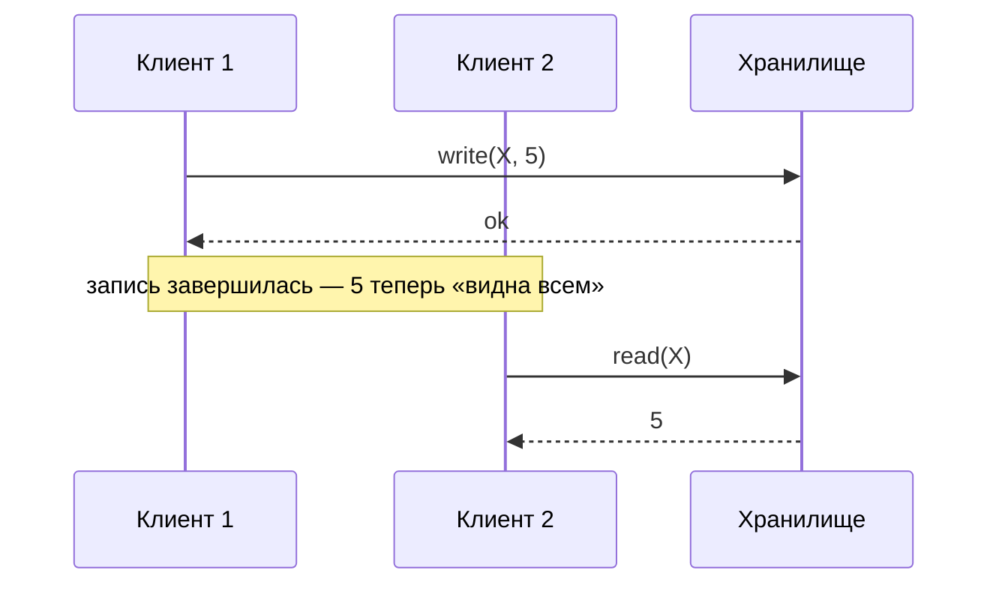
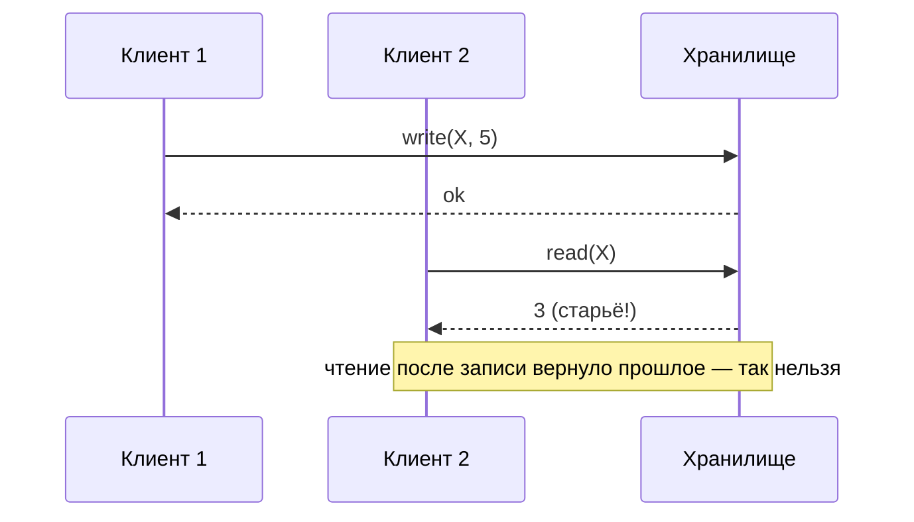
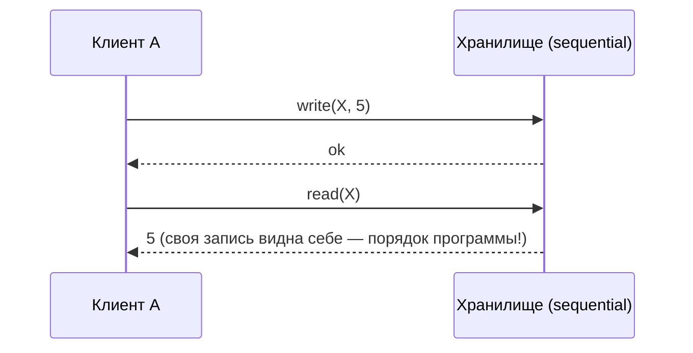
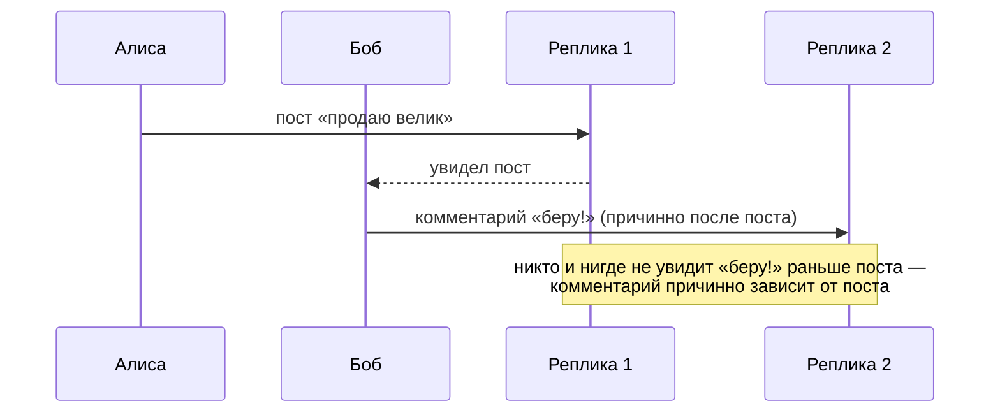
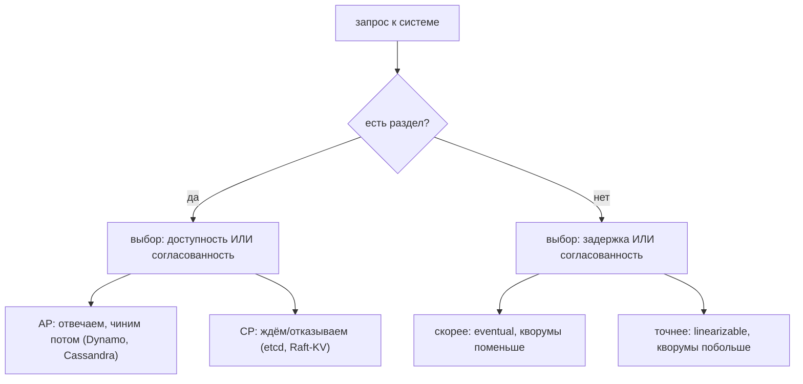

# 04 — Модели согласованности

Зачем это нужно: модель согласованности — это **контракт между хранилищем и программистом**: какие странности в данных возможны, а какие исключены. Без неё нельзя выбрать базу: требовать от Cassandra поведения Spanner'а так же бессмысленно, как требовать от почты скорости звонка. А ещё это ответ на вопрос «что именно даёт мой Raft-кластер клиенту» (спойлер: linearizability для одиночных операций — но не для транзакций, это разные вещи).

Идея раздела в одном предложении: **чем сильнее гарантия порядка, тем дороже каждая операция — шкала от linearizability до eventual consistency это шкала цены.**

---

## 1. Linearizability: «как будто один сервер и атомарные операции»

Самая сильная модель для одиночных операций (Герили–Уинг, 1990). Две требования:

1. Все операции выглядят мгновенными: у каждой есть **точка линеаризации** — момент между её началом и концом, когда она «как будто» произошла.
2. Точки идут в порядке реального времени: если операция A завершилась до начала B — A раньше B в этом порядке.

Пример — всё хорошо:

А вот нарушение: чтение началось **после** завершения записи, но вернуло старое значение. Значит, точки линеаризации расставить нельзя (запись обязана быть раньше чтения по реальному времени, а чтение «не видит» запись) — история **нелинеаризуема**:

Откуда берётся старьё на практике: чтение у follower'а без проверки (раздел `03` — ReadIndex не просто так придумали), чтение у старого лидера после раздела, кэш без инвалидации.

---

## 2. Sequential consistency: порядок есть, часы не смотрят

Ослабление: общий порядок операций существует и уважает порядок программы каждого клиента, но **к реальному времени не привязан**. История из прошлого примера (запись завершилась, чтение вернуло старьё) — sequential! Почему: выстроим порядок «сначала чтение (вернуло 3 — тогда тройка ещё актуальна), потом запись 5». Порядок программы никто не нарушил (у каждого клиента по одной операции), реальное время sequential-модели безразлично.

Когда разница видна:

Свои операции клиент всегда видит в своём порядке (это же даст и read-your-writes ниже), а вот чужие могут «опаздывать» сколь угодно — в отличие от linearizability, где опоздавших после завершения операции не бывает.

Практика: ZooKeeper даёт sequential (zxid — глобальный порядок), и этого достаточно для координации. Linearizability (etcd, Raft-KV) нужна там, где клиент после записи сразу читает и требует актуальности.

---

## 3. Causal consistency: упорядочено только связанное причинностью

Ещё слабее: порядок гарантируется только для причинно связанных операций (`→` из раздела `01`). Параллельные записи разные реплики могут увидеть в разном порядке.

Пример — чат:

А два независимых поста Алисы и Боба реплики вправе показать в разном порядке — они параллельны, пользователя это не смущает (так живут ленты соцсетей). Реализация — векторные часы из `01`: реплика применяет запись, только когда применила всё, от чего та зависит.

---

## 4. Eventual consistency и сессионные гарантии

Eventual: **если обновления прекратятся — реплики сойдутся**. Между «прекратятся» и «сошлись» — любые чудеса: старьё, переупорядочивание, временные конфликты. Само по себе — слабая гарантия, поэтому её усиливают **сессионными** (в пределах одного клиента):

- **read-your-writes**: свою запись клиент видит сразу (иначе «я только что сохранил, где оно?!»);
- **monotonic reads**: прочитал новое — старое больше не увидишь (лечит «прыгание» между репликами через sticky sessions);
- **monotonic writes**: записи одного клиента применяются в его порядке;
- **writes-follow-reads**: пишешь на основе прочитанного — запись встанет после прочитанного (нужно для «ответ на комментарий»).

Сессионные гарантии — дешёвый способ сделать eventual-систему терпимой: липкие сессии + version vectors творят чудеса без глобальной координации.

---

## 5. Serializability: то же, но для транзакций

Всё выше — про одиночные read/write. **Serializability** — про транзакции: результат concurrent-выполнения эквивалентен **какому-то** последовательному порядку тех же транзакций. Какому именно — неважно, важно, что такой существует.

Классика жанра — **write skew** (перекос записи), который ловит даже snapshot isolation:

| | Дежурный 1 (Алиса) | Дежурный 2 (Боб) |
|---|---|---|
| 1 | читает: дежурят Алиса и Боб (≥1 — ок) | читает: дежурят Алиса и Боб (≥1 — ок) |
| 2 | снимает себя с дежурства | снимает себя с дежурства |
| 3 | коммит | коммит |

Итог: дежурит **ноль** врачей, правило «хоть один» нарушено. Каждая транзакция по отдельности видела корректный снимок и никого не перезаписывала (писали разные строки!) — поэтому snapshot isolation это пропускает. А serializability — нет: ни в каком последовательном порядке так получиться не могло (второй в очереди увидел бы «остался один» и отказался).

Выводы:

- **Snapshot isolation ≠ serializability.** SI даёт каждой транзакции снимок на момент старта — чтение стабильно, но ограничение целостности между строками не проверяется.
- Лечится: **SSI** (serializable snapshot isolation — база сама отслеживает опасные rw-зависимости и абортит одну), явными блокировками (`SELECT FOR UPDATE`), или материализацией конфликта (одна строка-счётчик, за которую все дерутся).
- **Strict serializability = serializability + linearizability**: транзакции и упорядочены последовательно, и уважают реальное время. Это то, что даёт Spanner (и за что платит commit-wait'ом из `01`).

---

## 6. CAP и PACELC: выбираем, чем платить

**CAP**: при сетевом разделе (P) выбираешь между согласованностью (C) и доступностью (A). «CA-система» без P — это один сервер, не распределённая система. На практике точнее **PACELC**:

Даже без разделов цена согласованности — latency: linearizable чтение идёт к лидеру/кворуму, eventual — к ближайшей реплике. Отсюда **tunable consistency (NWR)**: `R + W > N` — строже, `R + W ≤ N` — быстрее. И **harvest/yield**: лучше отдать частичный ответ (поиск, DNS), чем упасть — доступность бывает важнее полноты.

---

## Шпаргалка

| Модель | Гарантия одной фразой | Цена |
|---|---|---|
| Linearizability | операции мгновенны в реальном времени | кворум/лидер на каждую операцию |
| Sequential | общий порядок, без привязки ко времени | свежесть чужих записей не гарантирована |
| Causal | порядок только причинно связанного | параллельное — в любом порядке |
| Eventual | сойдёмся, когда обновления кончатся | до сходимости — что угодно |
| Сессионные | «мои» операции ведут себя прилично | липкие сессии / векторы |
| Serializability | транзакции как будто по очереди | конфликты, аборты, retries |
| Snapshot isolation | стабильный снимок на транзакцию | write skew (не serializable!) |
| Strict serializability | SI + реальное время | Spanner-цена: часы + ожидание |
| CAP/PACELC | при разделе: C или A; без: latency или C | осознанный выбор, а не надежда |

Типичные ошибки новичка:

1. «Возьму eventual-базу и буду жить как с linearizable». Первый же раздел покажет старьё после собственной записи. Модель надо выбирать под требования, а не под хайп.
2. «Snapshot isolation — это почти serializable». Write skew говорит «нет». Либо SSI/блокировки, либо принять аномалию явно.
3. «CAP — это выбрать два из трёх раз и навсегда». Нет: выбор делается **на каждый запрос** (PACELC), и «без раздела» ты всё равно платишь latency за строгость.

Дальше: `05` — как эти модели реализуются репликацией (от chain до CRDT); `07` — транзакции и уровни изоляции в бою (2PC, Spanner, CockroachDB).
