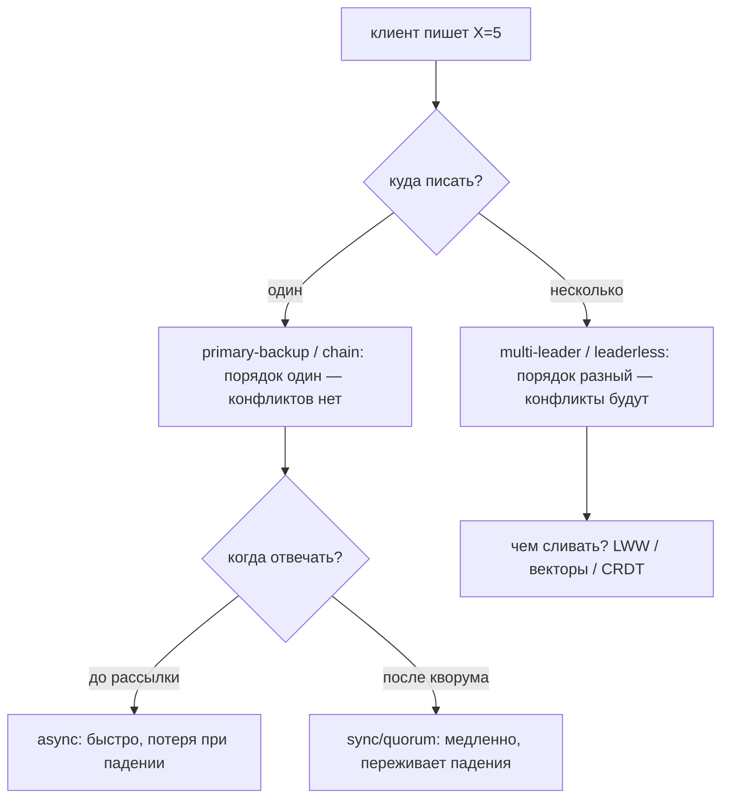
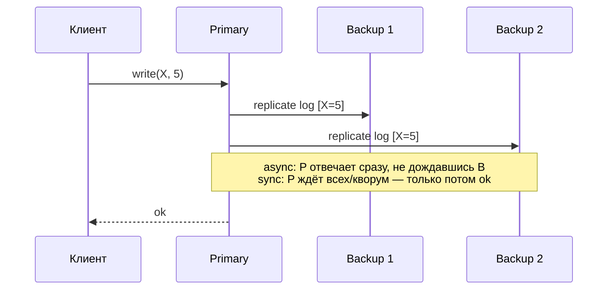
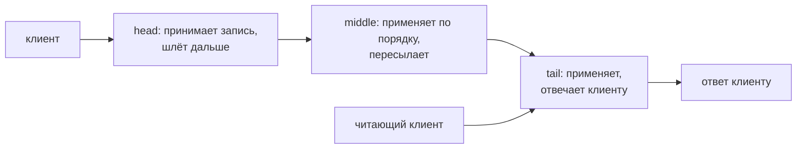
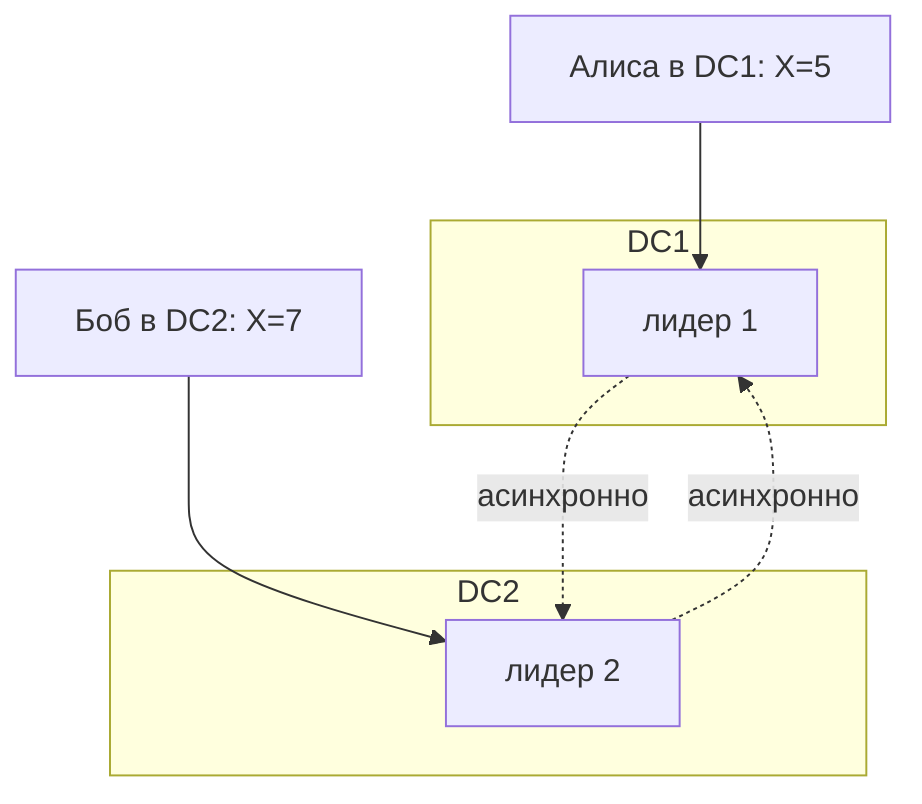
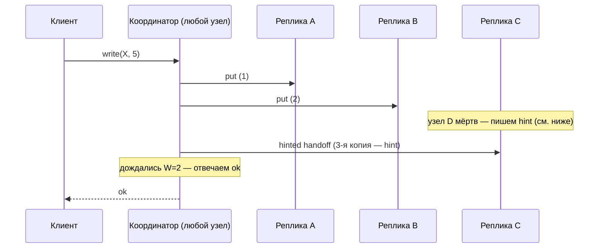
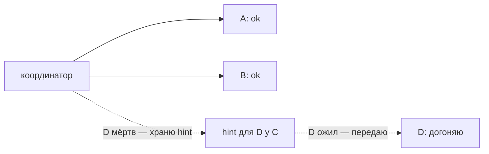
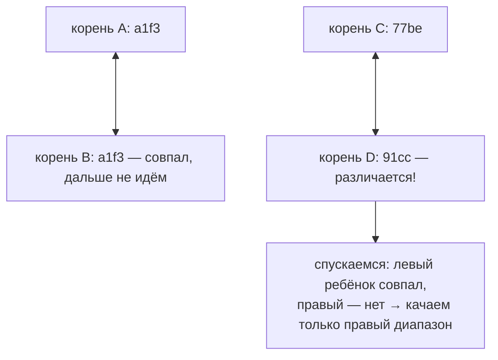
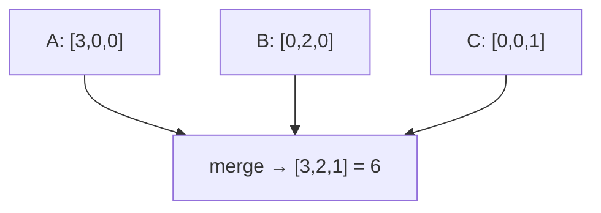
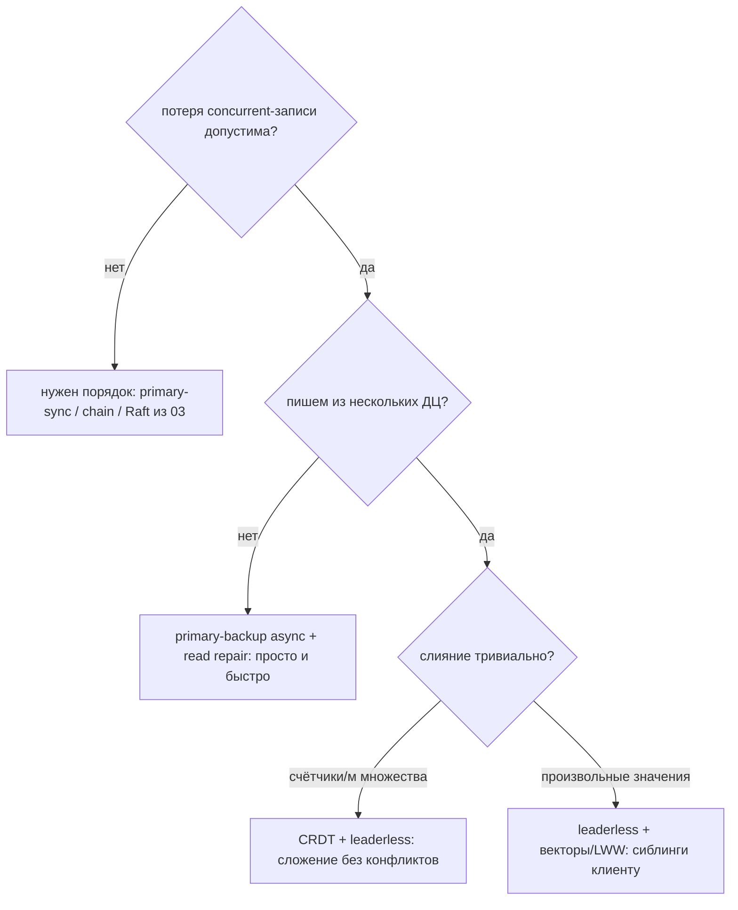

# 05 — Репликация данных

Зачем это нужно: один сервер умирает, тормозит и не тянет нагрузку. Поэтому данные хранят в нескольких копиях — **репликах**. Но копии разъезжаются: клиент пишет на одну, читает с другой, сеть рвётся посередине. Вопрос раздела: **куда разрешать запись, когда отвечать клиенту «готово» и как чинить разошедшиеся копии**. От ответов зависит всё: потеряем ли данные при падении, увидит ли клиент свою запись, нужен ли нам консенсус из `03` вообще.

Идея раздела в одном предложении: **репликация — это компромисс между тем, сколько копий подтверждает операцию (цена и надёжность) и что делать, когда копии разошлись (запретить расхождение или научиться его сливать).**

Отличие от `03`: там мы строили **один общий лог** через консенсус (Raft/Paxos) — расхождений не бывает по построению, но каждая запись платит кворумом и недоступна в разделе. Здесь — весь спектр, где расхождения либо возможны, либо чинятся без консенсуса: от primary-backup до CRDT.

Связь с прошлыми разделами: кворумы `W+R>N` — из `03`; version vectors — из `01`; модели из `04` — это то, что репликация даёт клиенту; детекторы из `02` — это как мы замечаем смерть primary.

---

## 1. Три вопроса любой репликации

На любую схему отвечайте так:

1. **Куда можно писать?** В один узел (primary/leader), в любой (leaderless), в несколько (multi-leader), по цепочке (chain).
2. **Когда отвечать клиенту «ок»?** До рассылки (async — быстро, можно потерять), после всех/кворума (sync — надёжно, медленно), после части (semi-sync, quorum `W`).
3. **Что делать с расхождением?** Не допускать (консенсус, chain, синхронный primary) или чинить потом (last-writer-wins, векторы + слияние, CRDT, anti-entropy).

Запомните ось: **влево — запрещаем расхождение (платим доступностью и задержкой), вправо — разрешаем и чиним (платим сложностью слияния и странностями для клиента).**

---

## 2. Primary-backup: один пишет, остальные повторяют

Классика: Postgres, MySQL, MongoDB, etcd поверх Raft (там primary = лидер). Один **primary** принимает все записи, рассылает лог, **backup/secondaries** применяют по порядку. Чтение — либо только с primary (сильно), либо с backup'ов (быстро, но старьё).

Три режима рассылки:

- **Async (Postgres async standby по умолчанию).** Primary отвечает, не дождавшись никого. Задержка минимальна, но падение primary до отправки = потеря подтверждённых записей. Клиент увидел «ок», данных уже нет.
- **Sync (Postgres `synchronous_commit = on`, MySQL semi-sync).** Primary ждёт хотя бы одну/все синхронные реплики. Потерь нет (пока жива хоть одна синхронная копия), но каждая запись платит RTT до backup'а и встаёт при его смерти/разделе.
- **Semi-sync / quorum (`W`).** Ждём `W` из `N`: середина между первыми двумя. Тот же `W` из формулы `W+R>N` раздела `03`–`04`: хочешь читать свежак с `R` — подбери `W` так, чтобы пересекались.

Главная боль — **failover**: primary умер, кого назначить новым?

1. Детектор из `02` говорит «primary мёртв» (может врать при GC-паузе!).
2. Выбираем самый свежий backup (у кого длиннее лог).
3. Переключаем клиентов.

Без fencing'а получаем **split-brain**: старый primary «воскресает» (это был не краш, а раздел) и продолжает принимать записи — теперь два primary с разным логом. Лечится:

- **Fencing (подробнее в `09`):** новому primary выдаём монотонный epoch/токен, хранилище/прокси отвергает записи со старым токеном. Воскресший primary пишет с `epoch=5`, а все уже требуют `6` — его записи отбиваются.
- **Только большинство может выбрать primary** (то есть выборы через консенсус — мост обратно в `03`: Raft и есть primary-backup, где выборы безопасны).

Чтение с backup'а: дёшево и масштабирует чтения, но **нелинеаризуемо** (привет, `04`): backup отстаёт на lag, а после failover'а новый primary может не содержать последних записей старого (если была async-репликация). Хочешь свежесть — читай с primary или делай ReadIndex/quorum read.

---

## 3. Chain replication: сильный порядок без консенсуса на каждую запись

Идея (van Renesse–Schneider, 2004): выстроим `N` реплик в цепочку. Записи идут только в **голову (head)**, чтения — только с **хвоста (tail)**, середина просто пересылает дальше по порядку.

Почему это сильно:

- Порядок задаёт head единолично — инверсий нет, все видят одно и то же в одном порядке (linearizability при чтении с tail и записи в head).
- Отказоустойчивость `f` при `N = f+1`: упал middle — соседи смыкаются, хвост/голова переназначаются координатором (ZooKeeper/etcd снаружи).
- Чтение не дёргает всю цепочку — только tail, задержка стабильна.

Цена:

- Запись проходит все `N` хопов — latency растёт с длиной цепочки.
- Пропускная способность упирается в самый медленный узел цепочки; на запись не масштабируется (в отличие от шардирования из `06`).
- Failover всё равно нужен внешний координатор + урезание «дыр» в цепочке: если head упала, не успев переслать, запись либо потеряна (и клиенту надо ретраить), либо её дошлёт новый head из своего лога.

Расширение — **CRAQ (Chain Replication with Apportioned Queries)**: читать можно с любого узла, но не-tail узел сначала спрашивает у tail «чистая ли версия?» (digest). Чтения масштабируются, свежесть сохраняется ценой одного запроса к tail.

Когда брать: линейка из нескольких копий в одном ДЦ, где нужен сильный порядок, а полноценный Raft кажется тяжёлым, и запись идёт в одно место. Исторический пример — хранилище в Microsoft (FDS), файловая репликация.

---

## 4. Multi-leader: пишем везде, страдаем при слиянии

Мотивация: несколько дата-центров, в каждом — свой лидер (меньше задержка для локальных клиентов, переживаем смерть целого ДЦ). Каждый лидер принимает записи локально и **асинхронно** рассылает остальным. Пример: MySQL active-active, PostgreSQL BDR, Git (каждый клон — лидер!).

Конфликт неизбежен: Алиса и Боб одновременно пишут один ключ на разных лидерах. Варианты разрешения:

- **Last-writer-wins (LWW) по timestamp.** Просто, но timestamp — wall-clock (привет, skew из `01`!): «позже» по часам не значит «позже» по смыслу, запись может молча проиграть. Годится для кэшей/сессий, смертельно для денег/счётчиков.
- **Version vectors + ручное слияние** (как в `01`): храним сиблингов, отдаём обе версии клиенту, клиент сливает и пишет назад. Правильно, но клиент обязан уметь сливать.
- **CRDT** (раздел 7 ниже): структура данных сама сливается без участия клиента.
- **Избежать конфликта конструкцией**: каждый лидер владеет своей частью ключей (partitioned leadership) или своими полями записи. Тогда multi-leader вырождается в несколько primary-backup — конфликтов нет по построению.

Правило большого пальца: **multi-leader без продуманного слияния — это async primary-backup с двумя primary, то есть split-brain как штатный режим.** Если слияние не коммутативно и не идемпотентно — будет потеря записей (та же беда, что «перезапись хвоста» в Raft, только теперь молча и в проде).

---

## 5. Leaderless и Dynamo-стиль: кворумы вместо лидера

Идея Dynamo (Amazon, 2007) / Cassandra / Riak: лидера нет вообще. Координатором становится **любой узел, к которому пришёл клиент**. Он пишет на `W` из `N` реплик (обычно первые `N` по consistent hashing — подробнее в `06`), читает с `R`, чинит расхождения потом.

### 5.1. N, R, W: ручка настройки

- `N` — число реплик ключа.
- `W` — сколько должны подтвердить запись.
- `R` — со скольких читаем и выбираем свежее (по вектору/timestamp).

`R + W > N` → пересечение, читаем свежее (как в `03`). `R + W ≤ N` → быстрее, но возможно старьё. Типично `N=3, R=2, W=2`: переживаем смерть одного, платим двумя RTT.

Строгий кворум — ещё не linearizability! Без общего порядка два concurrent-писателя создадут сиблингов, и читатель увидит оба. Кворум гарантирует пересечение, а не порядок.

### 5.2. Sloppy quorums и hinted handoff: доступность любой ценой

Строгий кворум требует `W` из **тех самых** `N` узлов. Упали двое из трёх — запись встала. Dynamo ослабляет:

- **Sloppy quorum:** берём любые `W` **живых** узлов кластера, не обязательно из первой `N`-ки. Пишем туда + кладём **hint**: «это вообще-то для узла D, отдашь, когда оживёт».
- **Hinted handoff:** когда D возвращается, координатор доставляет hint'ы. Временно данные лежат не там, где должны (нарушаем placement), зато запись не встала ни при каком разделе, пока живо `W` узлов вообще.

Hint — не вечен: держим ограниченное время (иначе диск координатора забьётся). Не успел отдать — дальше чинит anti-entropy (раздел 6).

### 5.3. Virtual nodes: ровные шарды без перекоса

Физических узлов мало (десятки), ключей — миллиарды. Если резать кольцо хеша на `N_физ` кусков — куски неровные, плюс добавление узла двигает половину данных. Решение — **виртуальные узлы (vnodes)**: каждый физический узел владеет сотнями случайных токенов на кольце. Ключ отдаётся первым `N` vnode по часовой стрелке.

Эффекты: нагрузка ровная (закон больших чисел сглаживает), добавление/удаление узла трогает только маленькие кусочки у многих соседей, hint'ы и repair идут параллельно. Подробнее механика кольца — в `06`, здесь важно: vnodes — причина, почему Dynamo-кластер переживает смерть узла без ручной перебалансировки.

### 5.4. Чтение и read repair

Чтение с `R`: координатор шлёт запросы, собирает версии с векторами, выбирает потомков, сиблингов отдаёт клиенту. Параллельно — **read repair**: заметил, что на какой-то реплике старьё — асинхронно (или синхронно, если `R` требует) дотягивает её до свежего. Горячие ключи чинятся сами собой чтением; холодные — anti-entropy'ей (раздел 6).

Оптимизация — **digest reads**: сначала запрашиваем только хеши версий, полные значения тянем лишь с расходящихся реплик. Меньше трафика на свежих данных.

---

## 6. Anti-entropy: как сойтись, если разошлись

Фоновая починка расхождений, три механизма (обычно все три сразу):

| Механизм | Когда срабатывает | Что делает | Цена |
|---|---|---|---|
| Hinted handoff | узел вернулся быстро | отдаёт временные hint'ы | память/диск координатора, TTL |
| Read repair | при чтении заметили старьё | дотягивает отставших | чинит только горячее |
| Merkle + gossip | фоном, для всего | находит и сверяет расходящиеся диапазоны | CPU/диск на построение дерева |

### 6.1. Merkle-деревья: найти различие за логарифм

Данные разбиты на диапазоны (партиции). Для каждого диапазона строим дерево: листья — хеши ключей/значений, родители — хеш конкатенации детей. Корни сверяем между репликами:

Совпал корень — диапазоны идентичны, дальше не идём. Различается — спускаемся только по различающейся ветке. Итог: вместо «перекачай всё» — «перекачай только различающиеся куски». Именно так чинятся холодные данные в Cassandra/Dynamo/Riak. Построение дерева — не бесплатно (полный проход по диапазону), поэтому запускают периодически и rate-limit'ят.

### 6.2. Gossip: слухи как транспорт

Gossip из `02` (SWIM) здесь везёт не только «кто жив», но и **дайджесты версий**: узлы периодически обмениваются «у меня для диапазона D корень такой-то / версия такая-то». Увидел отставание — запросил недостающее. Свойства те же: децентрализовано, нагрузка ровная (`O(1)` сообщений на узел за раунд независимо от размера кластера), сходимость — за логарифмическое число раундов, но **без дедлайна**: gossip гарантирует eventual, а не «к пятнице».

На практике связка такая: gossip находит *подозрение* («у тебя старее»), Merkle уточняет *что именно*, read repair + hinted handoff *доставляют*.

---

## 7. CRDT: структура данных, которая сливается сама

Проблема всех схем выше: слияние — ручная работа (клиент/код). **CRDT (conflict-free replicated data type)** перекладывает её на структуру данных: concurrent-обновления на разных репликах всегда сливаются в один результат, независимо от порядка доставки. Требование математическое: слияние должно быть **ассоциативным, коммутативным и идемпотентным**. Тогда eventual convergence — по построению, без консенсуса.

Два вкуса:

- **CvRDT (convergent):** реплики обмениваются состояниями, `merge(a, b)` — join полурешётки. Проще рассуждать, тяжелее слать (целые состояния), лечится delta-CRDT (шлём только дельту).
- **CmRDT (operation-based):** рассылаем операции, доставка — причинная (каузальная) + дубли/переупорядочивание переживаем. Легче трафик, сложнее транспорт.

Разберём четыре канонических типа (этого хватает на 90% собеседований и задач):

### 7.1. G-Counter (только рост)

Вектор длины `N`: каждый узел инкрементит **только свой** слот. Значение — сумма. Слияние — поэлементный `max`.

Почему сходится: инкременты не теряются (свой слот только растёт, `max` их сохраняет), дубли безопасны (идемпотентно). Применение: лайки, просмотры, счётчики «всего».

### 7.2. PN-Counter (рост и падение)

Два G-Counter'а: `P` (плюсы) и `M` (минусы). Значение = `sum(P) − sum(M)`. Инкремент — в `P`, декремент — в `M`. Слияние — покомпонентно. Нельзя сделать «один счётчик с ±», потому что concurrent `+1` и `−1` на разных репликах нельзя упорядочить без потерь — а два монотонных счётчика можно.

### 7.3. LWW-Register (последний пишет — побеждает)

Храним `(timestamp, value)`, побеждает больший timestamp, при равенстве — больший `node_id` (детерминированный tie-break). Слияние — взять максимум по паре.

Ловушка — та же, что в multi-leader: **timestamp — wall-clock**. При skew «последний» проигрывает «наглому» (часы убежали вперёд — его запись всегда побеждает), concurrent-записи молча теряются (одна затирает другую без следа). Поэтому LWW — только для флагов/аватарок/«текущий статус», где потеря терпима. Никогда для счётчиков и корзин.

### 7.4. OR-Set (множество с наблюдаемым удалением)

Наивные множества не сливаются: A добавляет `x`, B параллельно удаляет `x` — что должно остаться? **OR-Set (observed-remove)** решает тегами: каждое добавление — `(x, уникальный_тег)`, удаление — «убрать только те теги, что я **видел**». Параллельное добавление (невидимый удалявшему тег) переживает удаление.

Пример:

1. Реплики видели `{x#1}`. A добавляет `x#2` (параллельно), B удаляет `x` (видел только `#1` → убирает `#1`).
2. Слияние: `#1` удалён везде, `#2` — жив. Итог `{x#2}` — интуитивно верно: «удалил то, что видел, новое не трогал».

Цена — рост метаданных (теги, tombstone'ы удалённого). На практике — корзина в интернет-магазине, список участников, коллаборативные списки. Для текста поверх той же идеи — sequence-CRDT (RGA, Yjs/Automerge).

Ограничение CRDT честно: **слияние всегда детерминировано, но не всегда осмысленно для бизнеса** («два человека одновременно забронировали последнее место» — CRDT даст оба бронирования, а бизнес-правило «место одно» требует арбитра — консенсуса). CRDT хороши там, где concurrent-правки можно сложить (счётчики, множества, флаги), а не выбрать одну.

---

## 8. Что выбрать: карта решений

| Схема | Запись | Чтение | Конфликты | Пример |
|---|---|---|---|---|
| Primary-backup sync | primary + `W` | primary / quorum | нет (порядок один) | Postgres sync, etcd |
| Primary-backup async | primary сразу | любой backup (старьё!) | нет, но потеря при failover | Postgres async, MySQL |
| Chain | head, ждать tail | tail (или любой в CRAQ) | нет | FDS, CRAQ |
| Multi-leader | локальный лидер | локально | LWW / векторы / CRDT | BDR, active-active |
| Leaderless (Dynamo) | `W` из `N` + hints | `R` + repair | сиблинги + слияние | Cassandra, Riak, DynamoDB |

---

## Шпаргалка

| Понятие | Суть одной фразой | Ловушка |
|---|---|---|
| Async vs sync | когда отвечаем «ок»: до или после рассылки | async теряет подтверждённое при падении primary |
| Failover + fencing | новый primary с epoch отбивает старого | без fencing — split-brain с двумя писателями |
| Chain (head→tail) | пишет head, читает tail, порядок один | latency `N` хопов, нужен внешний координатор |
| CRAQ | чтение с любого + проверка у tail | лишний digest-запрос на чтение |
| Multi-leader | лидер в каждом ДЦ, рассылка async | штатный split-brain, нужно слияние |
| N/R/W | `R+W>N` — пересечение | кворум ≠ linearizability (сиблинги остаются) |
| Sloppy quorum | пишем любым живым + hint | данные временно не там, где должны |
| Hinted handoff | hint догоняет вернувшийся узел | TTL: не успел — только anti-entropy |
| Virtual nodes | сотни токенов на узел — ровная нагрузка | маппинг сложнее дебажить |
| Read repair | чтение дотягивает отставших | чинит только горячее |
| Merkle-дерево | сверяем корни, качаем различающееся | построение — полный проход, rate-limit |
| Gossip | слухи о версиях сходятся за `O(log N)` раундов | без дедлайна — только eventual |
| G-Counter / PN-Counter | свой слот + `max`, плюсы/минусы раздельно | размер `O(N_узлов)` |
| LWW-Register | побеждает больший `(ts, node_id)` | skew часов + молчаливая потеря |
| OR-Set | удаление только виденных тегов | теги/tombstone'ы растут |

Типичные ошибки новичка:

1. «Кворум `R+W>N` — значит, linearizable». Нет: пересечение гарантирует, что свежее *найдём*, но concurrent-записи дадут сиблингов. Порядок даёт только один писатель/лог (`03`, chain).
2. «Async-репликация + failover — надёжно, ведь копий две». Подтверждённая запись жила только на primary — после его смерти её нет нигде. Надёжность = что дождались до ответа, а не сколько копий «где-то будет».
3. «LWW решит конфликты». LWW спрячет их ценой потерь + зависимости от часов. Для денег/счётчиков — векторы или CRDT, для уникальности — консенсус.
4. «CRDT можно всё». CRDT складывает, но не выбирает: «последнее место» или «уникальный логин» требуют арбитра. Не хватает бизнес-инварианта — иди в `03`/`07`.
5. «Read repair чинит всё». Только горячие ключи. Холодные без Merkle-anti-entropy гниют месяцами — планируй фоновый repair явно.

Дальше: `06` — как резать данные на шарды (consistent hashing, vnodes в деталях, hot spots); `07` — транзакции поверх репликации (2PC, Spanner); `08` — ретраи без двойных записей.

Подробно про Dynamo-дизайн (sloppy quorums, hinted handoff, Merkle, vnodes):
https://habr.com/ru/articles/564274/
